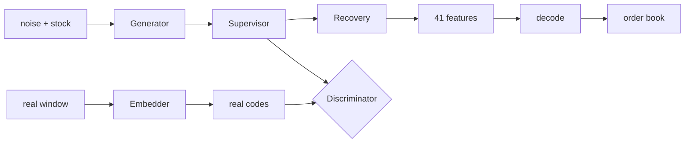
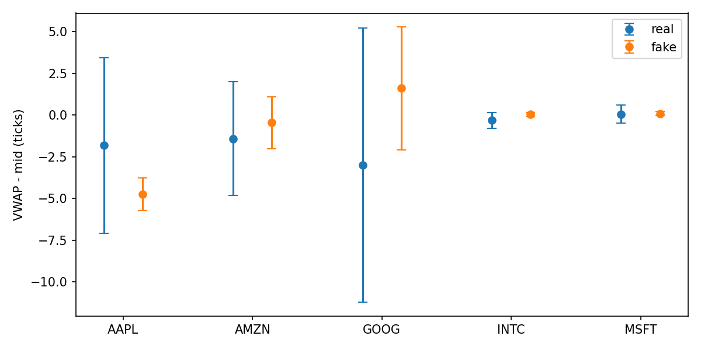
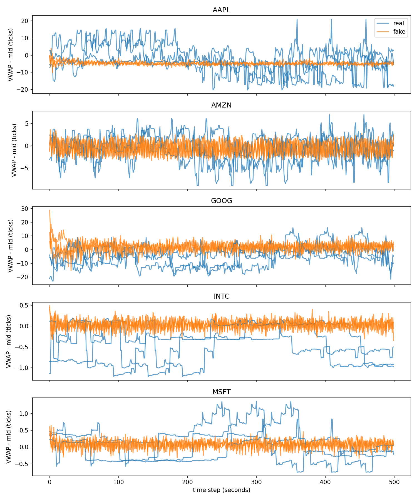
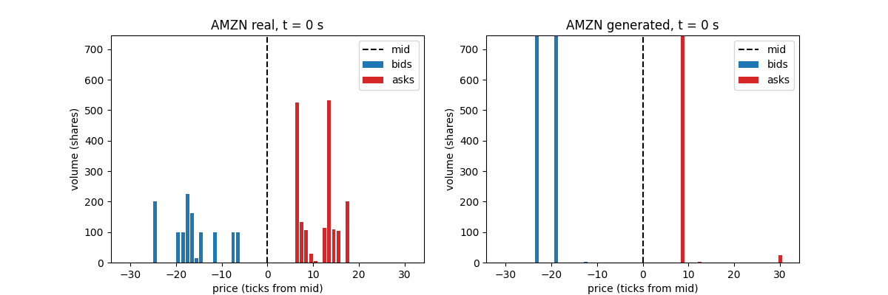
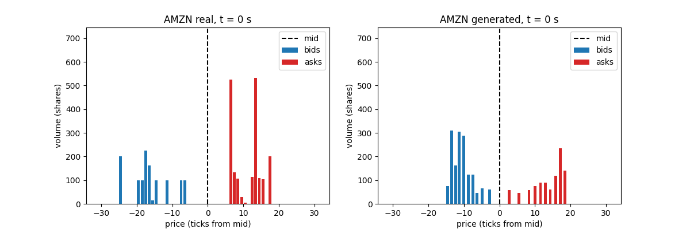
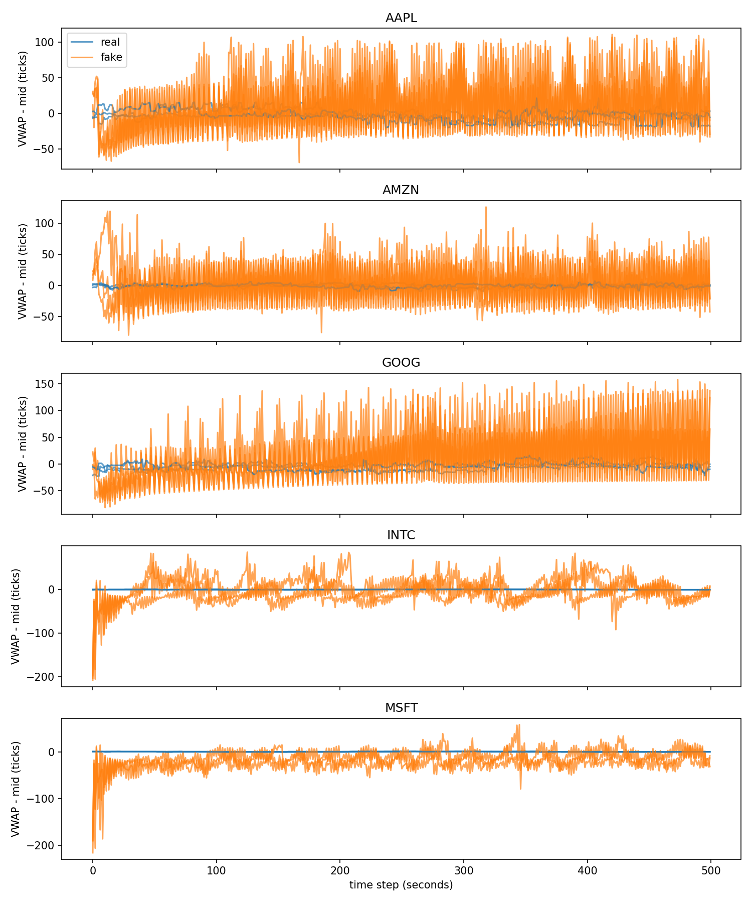

# Conditional TimeGAN for Limit Order Book Simulation (LOBSTER, 5 stocks)

**Author:** Catherine Aurellia (s4980053) · COMP3710 Pattern Recognition, The University of Queensland, 2026 · Project 2.7, Hard difficulty

This project tests whether TimeGAN learns the rules of a limit order book better than a plain GAN. Both models are conditioned on the stock and generate 500-second windows of the 10-level order book for five stocks. The plain GAN fools its discriminator but breaks the price ladder in every generated snapshot. TimeGAN, stopped just before its training collapsed, produces books that obey every rule for all five stocks and preserves each stock's character, but its prices move too calmly: its VWAP varies only 20–50% as much as the real data. The generated books are therefore suitable for testing a trading system's logic, but not for estimating its profit or risk.

## Contents
- [Code structure](#code-structure)
- [1. The problem](#1-the-problem)
- [2. How it works](#2-how-it-works)
- [3. Feasibility review](#3-feasibility-review)
- [4. Data and preprocessing](#4-data-and-preprocessing)
- [5. Baseline](#5-baseline)
- [6. Evaluation metrics](#6-evaluation-metrics)
- [7. Results](#7-results)
- [8. Failed experiments and iterations](#8-failed-experiments-and-iterations)
- [9. Failure autopsy](#9-failure-autopsy)
- [10. Recommendation](#10-recommendation)
- [11. Usage](#11-usage)
- [12. Dependencies](#12-dependencies)
- [Artificial Intelligence Usage Disclosure](#artificial-intelligence-usage-disclosure)
- [References](#references)

## Code structure
| File | Contents |
|---|---|
| `data_audit.py` | First look at the AMZN files: shape, time range, crossed books, placeholder levels, halts, event-by-event changes |
| `dataset.py` | Loading the five stocks, rule checker, 1-second resampling, feature encoding/decoding, time split, shared normaliser, 500-step windows with stock labels |
| `modules.py` | The networks: shared GRU block, conditioned baseline GAN, conditioned TimeGAN (embedder, recovery, supervisor, generator, discriminator) |
| `train.py` | Training loops for the baseline and TimeGAN's three phases, rule penalty, checkpoints, resume, evaluation of the trained model |
| `utils.py` | Evaluation: decoding windows into books, rule-violation rates, VWAP offset, volatility clustering, KL divergence, per-stock report |
| `predict.py` | Loads a trained model, generates 200 windows per stock, prints the per-stock report and a real-vs-real reference, saves figures and GIFs |
| `run_train.sh` | Slurm job script for Rangpur; model and options are chosen at submission time |
| `figures/` | Figures used in this README |

## 1. The problem
A limit order book is the list of all orders waiting to be traded in a stock: buyers' prices and sizes (bids) and sellers' prices and sizes (asks), ordered from the best price outwards. At any instant, every real book obeys three rules:

1. **Spread rule:** the best bid is below the best ask. If a buyer offered at least as much as a seller asked, the exchange would match them immediately, so a book with bid ≥ ask (a *crossed* book) never exists.
2. **Ladder rule:** ask prices rise and bid prices fall from level 1 to level 10, because level 1 is by definition the best price.
3. **Volume rule:** the number of shares waiting at each level is never negative.

Quantitative traders test (*backtest*) their trading algorithms on historical order books before using them with real money. Real high-frequency order book data is expensive and limited, so realistic synthetic data would let them test strategies much more widely. The danger is synthetic data that looks realistic but breaks these rules: a crossed book offers riskless "free money", so an algorithm backtested on it would report profits that cannot exist in a real market.

Generative models trained only to make data *look* similar have no built-in reason to respect these rules. The question this project investigates is therefore whether TimeGAN [1], whose supervised loss explicitly teaches step-to-step dynamics, learns the rules of the order book better than a plain GAN, and whether its output is reliable enough to backtest on.

## 2. How it works
TimeGAN [1] combines an **autoencoder**, a **supervisor** and a **GAN**. All five of its networks are built from the same block (`RecurrentBlock` in `modules.py`): a 3-layer GRU that reads a sequence step by step, followed by a linear layer at every step.

| Network | Input → output | Role |
|---|---|---|
| Embedder | 41 features → 24-number latent code (sigmoid) | compresses each second of the book into a code |
| Recovery | code → 41 features | turns codes back into order book features |
| Supervisor | code + stock → next code (sigmoid) | learns how the market moves from one second to the next |
| Generator | noise + stock → code (sigmoid) | produces fake code sequences |
| Discriminator | code + stock → real/fake score per step | judges whether a code sequence is real |

The adversarial game is played on **codes** rather than raw features: 24 compressed numbers, bounded between 0 and 1, are an easier and better-defined target for the generator than 41 noisy, correlated features. The supervisor adds what a plain GAN lacks: an explicit lesson about time, so generated sequences must not only look real at each step but also follow from one step to the next as real ones do.

To generate a book, noise passes through the generator, then the supervisor, then the recovery network:



**Training happens in three phases:**
1. **Autoencoder:** the embedder and recovery learn to rebuild real windows (mean squared error).
2. **Supervisor:** on codes of real windows, the supervisor learns to predict each next code. The embedder is frozen, so the supervisor learns from a fixed target, and phase 2 cannot undo the autoencoder trained in phase 1.
3. **Joint training:** in each batch, the generator and supervisor update twice and the discriminator once. The generator's loss combines fooling the discriminator, the supervisor's next-step error and a *moment loss* matching the average and spread of real windows (weights from the original paper). The autoencoder keeps training gently, and the discriminator skips its update when it is already winning (loss below 0.15), which keeps the game balanced.

**Conditioning on the stock.** Every window carries its stock as a one-hot vector (AAPL = [1,0,0,0,0], …, MSFT = [0,0,0,0,1]), attached to the input at every time step (`with_label` in `modules.py`). One-hot avoids implying that one stock is "larger" than another. The supervisor, generator and discriminator receive the label, so the model can learn and generate each stock's own behaviour; the embedder and recovery do not, as one compression tool is shared by all stocks.

## 3. Feasibility review
The review below is the one presented at the feasibility check-off (23 October 2026). Its evidence comes from the single-stock (AMZN), 60-step prototype. **Changes after the check-off:** the TA's feedback was to focus the results on VWAP-based metrics, to use all five LOBSTER stocks in one conditional model, and to train and generate 500-step sequences. The final pipeline (section 4) and results (section 7) follow that feedback.

#### User need, scope and acceptance criteria
**User.** A quant team that backtests trading algorithms but cannot afford enough real order book data. **Prototype.** A generator of realistic windows of the 10-level order book, plus checks that say whether the windows are safe to backtest on. **The danger** is data that looks realistic but breaks market rules: a crossed book creates fake "free money", so a backtest looks great and then fails live. **Scope.** One trading day (21 June 2012), 10 levels per side. Not covered: crashes, halts and other days.

| # | Criterion | Pass if | Why the user cares |
|---|---|---|---|
| 1 | Market rules | 0% of generated snapshots have best bid ≥ best ask, out-of-order price levels or negative volume | One invalid book is fake free money in a backtest |
| 2 | Book shape (VWAP) | Mean and spread of the VWAP offset from the mid match real data, with no collapse to one value | Depth sets the cost of large orders |
| 3 | Behaviour over time | Volatility clustering close to real | Strategies must face realistic calm and wild periods |
| 4 | Specification targets | KL ≤ 0.1 on spreads and returns, SSIM > 0.6 on depth heatmaps, each next to a real-vs-real reference | Required by the specification; the reference shows what is achievable |
| 5 | Resources | One run ≤ 3 h and < 4 GB on one A100 | The prototype must be practical to iterate on |

#### Model choice and course concepts
**Model (Hard).** TimeGAN [1]: autoencoder, supervisor and GAN, trained in three phases, with the authors' settings (hidden size 24, 3 GRU layers, batch 128). **Baseline.** A recurrent GAN [2] built from the same GRU block, without the autoencoder or supervisor. **Features.** Mid-price log-return, price offsets in ticks and log sizes: log sizes make negative volume impossible, but nothing protects the price ladder, so the model has to learn it. That is the experiment. **Course concepts.** Autoencoders (lab VAE), adversarial training and WGAN-GP (lab GAN), recurrent networks, leakage-free splitting.

#### Preliminary evidence (AMZN, 60-step windows)
| Evidence | Result | What it shows |
|---|---|---|
| Real data | 0 spread, ladder and volume violations in 269,748 snapshots; spread $0.01–$0.77 (median $0.13) | The target behaviour is clear |
| Data pipeline | 16,139 training, 60 validation, 60 test windows; validation standard deviation 0.85 after normalising | The afternoon differs from the morning, so a real-vs-real reference is needed |
| Baseline GAN (50 epochs) | 0.9 min, 90 MB; 100% of snapshots break the ladder; losses at chance level after epoch 22 | The discriminator was fooled while every book was invalid |
| Early (5-batch) generator | Only 2.1% broken ladders, but VWAP standard deviation 0.11 vs 3.40 | The metrics catch a collapsed model that the rule check misses |
| TimeGAN phases 1–2 | Test reconstruction error 0.160; supervisor beats a "no change" guess by 26% | The autoencoder generalises; the supervisor learned real dynamics |

#### Risks, budget and fallback
| Risk | Mitigation |
|---|---|
| One ordinary trading day | Scope stated explicitly; multi-stock model as a stretch goal |
| GAN instability | Monitor losses and metrics during training; WGAN-GP as a fallback |
| Specification targets unreachable or ambiguous | TA's metrics as the main tests; KL reported against a real-vs-real reference; confirm with the TA |

**Budget.** Well under one GPU-hour for the planned runs at prototype scale. **Fallback.** The baseline already works end to end; if phase 3 is unstable, simplify the model and report the failure analysis.

## 4. Data and preprocessing
### Source
The free LOBSTER sample files at Level 10 were used for five stocks (AAPL, AMZN, GOOG, INTC, MSFT) on 21 June 2012, 09:30–16:00. A single day of a single stock is very little data, and the five stocks have very different books (INTC and MSFT trade with a spread of about one tick, while GOOG's book is spread over many ticks), so using all five also tests whether the model learns stock-specific behaviour rather than one generic book. This follows the TA's TimeGAN recommendations [5] and the TA's feedback at the feasibility check-off.

### Audit
`check_rules` (`dataset.py`) counts snapshots that break the spread, ladder and volume rules; the same function is later used to score generated books. Across all 2.1 million events (from 147,916 for GOOG to 668,765 for MSFT) it found 0 crossed books, 0 broken ladders and 0 negative volumes, and a separate check found 0 empty (placeholder) levels and 0 trading halts. The real data therefore obeys every rule the generator must learn, and no cleaning was needed.

### Resampling
LOBSTER records the book after every event, so events arrive at irregular times. Using each event as one time step was considered first, but on AMZN a 60-event window lasted anywhere from 0.27 s to 15 s, and 90% of events did not change the mid-price, so "one step" had no consistent meaning. The data was therefore resampled to clock time: the book as it stands at the end of every second, carried forward through seconds with no events (4,366 of AMZN's 23,400 seconds). Every stock gets exactly 23,399 snapshots whether it is busy (MSFT) or quiet (GOOG), and returns and volatility clustering mean the same thing for every stock.

### Features
Each snapshot becomes 41 numbers (`encode` in `dataset.py`):
- **Mid-price log-return (1):** the price level drifts during the day, but its moves look similar throughout, so the model learns moves rather than absolute prices.
- **Ask and bid price offsets from the mid, in ticks (20):** these describe the shape of the book independently of the price level, so the same features work for INTC (about $26) and GOOG (about $560).
- **Log sizes (20):** volumes range from 1 to about 34,000 shares; the logarithm compresses this range, and decoding with `exp` makes a negative volume impossible.

`decode` reverses the encoding exactly: encoding then decoding the real AMZN book reproduces it to within 3 × 10⁻⁹, so no information is lost.

### Split
Each stock is split by time of day: training 09:30–14:00, validation 14:00–15:00 and test 15:00–16:00. Shuffling snapshots before splitting would leak information about the afternoon into training, because neighbouring seconds are almost identical. The afternoon also genuinely behaves differently: after normalising AMZN with morning statistics, its validation hour has a standard deviation of 0.85 rather than 1.

### Normalising
One mean and standard deviation per feature are computed from the training hours of all five stocks together and applied to every split, so nothing from the afternoon leaks into preprocessing. A shared normaliser keeps the stocks distinguishable after scaling (GOOG's wide book still looks wide next to INTC's narrow one), so the model has to use the stock label. This was initially suspected of hurting the tight-spread stocks, but section 8 shows the problem was in fact a training collapse.

### Windows
Windows of 500 steps were chosen because, at one step per second, they cover about 8 minutes of trading: long enough for calm and volatile stretches, and the jumps between them, to appear within a single window, so that the model has to learn temporal behaviour rather than just individual snapshots. This length was also the TA's instruction at the feasibility check-off. Training windows overlap with stride 1 (78,495 windows over five stocks), which gives many examples from limited data. The test hour only holds 7 non-overlapping windows of 500 steps per stock, so validation and test windows use stride 50 (315 windows each); this gives enough windows to compare distributions without counting the same seconds hundreds of times.

### Labels
Every window carries its stock as a label (AAPL = 0 … MSFT = 4), which the models use for conditioning (section 2).

## 5. Baseline
The baseline is a plain recurrent GAN [2, 3] conditioned on the stock (`BaselineGAN` in `modules.py`): a generator turns noise plus the stock label into 41-feature windows, and a discriminator scores real and generated windows per time step. It uses the same GRU building block, hidden size (24), number of layers (3), data, label conditioning and evaluation as TimeGAN, but has no autoencoder and no supervisor. Any difference between the two models can therefore be attributed to TimeGAN's additional components rather than to model size or data. It was trained for 50 epochs with binary cross-entropy (Adam, learning rate 10⁻³, batch 128); its losses settle by about epoch 25.

## 6. Evaluation metrics
All metrics are computed on **decoded** order books (prices and sizes), not on normalised features, per stock, comparing 200 generated windows per stock with the 63 real test windows of that stock (`per_stock_report` in `utils.py`). Following the TA's recommendations [5], the main metrics are:

| Metric | What it measures | Good value |
|---|---|---|
| **Broken ladders** | % of generated snapshots breaking the spread or ladder rule (`check_rules`) | 0% (real data: 0%) |
| **Huge volumes** | % of generated volumes larger than the largest real volume of that stock | 0% |
| **VWAP offset** | volume-weighted average price of the whole book minus the mid, in ticks; its mean shows where the book's weight sits, its standard deviation how much the book's balance moves | close to real |
| **Volatility clustering** | correlation between the size of one mid-price move and the next (the TA's suggested autocorrelation) | close to real (0.07–0.14) |

The specification's **KL divergence** on spreads and mid-price returns is also reported, using histograms with one-tick (or half-tick) bins so that continuous generated values are not penalised for not being whole ticks.

**Real-vs-real reference.** About 314 real windows from the training hours are scored against the real test hour with exactly the same metrics. This is the best a perfect generator could achieve, and it shows how much the test hour differs from the morning.

**Specification metrics.** The specification provides two target metrics: KL divergence ≤ 0.1 on spreads and returns, and SSIM > 0.6 on depth heatmaps. KL is reported in Section 7, but only as a secondary metric next to a real-vs-real reference, because it looks at one quantity at a time and cannot see whether the rest of the book is valid. **SSIM was not used**, for four reasons. First, SSIM was designed to compare an image with a degraded copy of itself, but a generated window has no corresponding real window, so any pairing is arbitrary and flawed:
- a random real window mostly measures how different two real windows are;
- the most similar real window rewards copying the training data;
- the average real heatmap would give a perfect score to a model that always outputs the average book;
- an autoencoder reconstruction measures the compression network rather than the generator.

Second, SSIM rewards smooth, averaged images, so it is weakest at catching exactly the collapsed, over-smoothed outputs this investigation needs to detect. Third, the depth structure SSIM was meant to assess is already covered by the VWAP offset (which combines prices and volumes across all levels), the rule checks and the order book animations. Fourth, no pairing was ever settled with the TA. Dropping SSIM was also supported by the TA, whose post described the specification's metrics as possibly "slightly inappropriate" and recommended VWAP-based and autocorrelation metrics instead [5].

**Choosing a checkpoint.** TimeGAN's phase 3 collapsed after a healthy period in every run (section 8), so checkpoints were saved every 10 epochs and the **last checkpoint before the collapse was chosen from the training losses alone** (epoch 40), never from test results, so the test hour stays unseen.

## 7. Results
**Summary of findings**
- **TimeGAN learned the order book's rules by itself:** 0% broken ladders and 0% impossible volumes for all five stocks, against 100% and 20–29% for the plain GAN.
- **It learned each stock's character:** its variation is ordered like the real data's, largest for GOOG and smallest for INTC and MSFT.
- **Its prices move too calmly:** VWAP variation is 20–50% of real, return KL is 0.9–3.9 against a real-vs-real reference of 0.01–0.06, and positive volatility clustering appears only for AAPL and GOOG.
- **Training collapses** after 40–60 epochs of phase 3, so checkpoints chosen from the training losses are essential. A rule penalty made both models worse.
- **The specification's KL ≤ 0.1 is unreachable even for real data** on the spreads of the wide-spread stocks (0.24–0.48), and KL rated a model with 100% invalid books as near-perfect.

Four models were compared: the baseline, the baseline with the rule penalty (section 8), TimeGAN at epoch 40, and TimeGAN with the rule penalty at epoch 60 (its last healthy checkpoint).

### Rules
| Stock | Baseline | Baseline + penalty | **TimeGAN** | TimeGAN + penalty |
|---|---|---|---|---|
| | broken ladders / huge volumes | | | |
| AAPL | 100% / 21.3% | 100% / 14.9% | **0.0% / 0.0%** | 100% / 0.0% |
| AMZN | 100% / 19.6% | 100% / 14.9% | **0.0% / 0.0%** | 100% / 0.0% |
| GOOG | 100% / 28.0% | 100% / 19.9% | **0.1% / 0.0%** | 2.4% / 0.0% |
| INTC | 100% / 28.9% | 100% / 5.1% | **0.0% / 0.0%** | 0.4% / 0.0% |
| MSFT | 100% / 28.5% | 100% / 5.0% | **0.0% / 0.0%** | 0.4% / 0.0% |

TimeGAN learned the order book's rules without being forced to: its books are valid for all five stocks, while every snapshot of the baseline breaks the price ladder and a quarter of its volumes exceed anything seen in the real data.

### VWAP offset (mean ± standard deviation, ticks)
| Stock | Real test hour | Reference (real morning) | Baseline | Baseline + penalty | **TimeGAN** | TimeGAN + penalty |
|---|---|---|---|---|---|---|
| AAPL | −1.82 ± 5.26 | −1.68 ± 8.63 | 6.65 ± 39.60 | 56.17 ± 7.84 | **−4.75 ± 0.98** | 6.93 ± 1.76 |
| AMZN | −1.41 ± 3.40 | −1.41 ± 5.30 | 1.72 ± 35.29 | 57.06 ± 7.88 | **−0.46 ± 1.56** | 5.10 ± 1.92 |
| GOOG | −3.00 ± 8.23 | −0.41 ± 16.91 | 18.55 ± 58.93 | 55.25 ± 7.76 | **1.60 ± 3.68** | 1.73 ± 5.48 |
| INTC | −0.32 ± 0.49 | −0.32 ± 0.62 | −3.73 ± 30.47 | 56.62 ± 7.41 | **0.04 ± 0.13** | 0.04 ± 0.14 |
| MSFT | 0.06 ± 0.54 | 0.00 ± 0.72 | −18.48 ± 20.44 | 53.23 ± 7.25 | **0.09 ± 0.13** | 0.04 ± 0.14 |

The baseline's books swing 5–60 times more than real ones. With the penalty, it collapsed to one book shape for every stock (≈ 55 ± 7.5 for all five), ignoring the label. TimeGAN preserves each stock's character: its variation is ordered like the real data's, largest for GOOG and smallest for INTC and MSFT, and its averages for INTC and MSFT are close to real. However, its variation is only 20–50% of the real test hour's, and lower still than the more volatile morning it was trained on, so it is genuinely too calm.


*Figure 1: VWAP offset per stock, real test hour (blue) and TimeGAN (orange), mean ± one standard deviation.*


*Figure 2: VWAP offset over time for the first three real (blue) and generated (orange) windows of each stock (not cherry-picked). Real books sit on plateaus and jump between levels; generated books jitter quickly around a steady level.*

### Volatility clustering
| Stock | Real | Reference | Baseline | Baseline + penalty | **TimeGAN** | TimeGAN + penalty |
|---|---|---|---|---|---|---|
| AAPL | 0.120 | 0.159 | −0.312 | 0.985 | **0.077** | 0.749 |
| AMZN | 0.126 | 0.144 | −0.228 | 0.984 | **−0.300** | −0.375 |
| GOOG | 0.135 | 0.111 | −0.221 | 0.985 | **0.046** | 0.643 |
| INTC | 0.079 | 0.074 | −0.369 | 0.986 | **−0.388** | 0.488 |
| MSFT | 0.073 | 0.064 | −0.385 | 0.985 | **−0.400** | 0.502 |

Only TimeGAN's AAPL and GOOG books show the positive clustering of real markets. Negative values mean big moves tend to be followed by small ones, i.e. step-to-step oscillation; values near 1 (baseline + penalty) mean every move is almost the same size, i.e. no real variation.

### KL divergence (specification's metric)
| Stock | Reference spread / return | Baseline spread / return | **TimeGAN** spread / return |
|---|---|---|---|
| AAPL | 0.479 / 0.012 | 5.157 / 2.293 | **6.926 / 0.926** |
| AMZN | 0.293 / 0.027 | 4.568 / 2.611 | **2.580 / 2.133** |
| GOOG | 0.241 / 0.010 | 12.218 / 3.292 | **9.821 / 1.374** |
| INTC | 0.002 / 0.063 | 0.248 / 3.683 | **0.035 / 3.595** |
| MSFT | 0.001 / 0.044 | 0.002 / 4.032 | **0.055 / 3.920** |

Even real morning data misses the specification's KL ≤ 0.1 target on spreads for AAPL, AMZN and GOOG (0.24–0.48), because spreads change during the day, so a fixed 0.1 is not a fair bar for these stocks. TimeGAN meets it for INTC and MSFT spreads. On returns, TimeGAN beats the baseline for the three wide-spread stocks, but both are far from the reference (0.01–0.06), consistent with the too-calm dynamics above. KL also shows why it cannot be the main metric: it rates the baseline's MSFT spreads as nearly perfect (0.002) although 100% of those books are invalid, because it looks at one number's distribution and not at the rest of the book.

### Generated order books

*Figure 3: AMZN order book over 500 seconds, real (left) and baseline (right), both on the real window's scale. Bars running off the top are volumes larger than any real volume.*


*Figure 4: The same for TimeGAN.*

### Resource profile
| Model | Parameters | Training (A100) | Peak GPU memory |
|---|---|---|---|
| Baseline | 25,818 | 12.1 min (50 epochs) | 640 MB |
| TimeGAN | 60,378 | 132.7 min (100 + 100 + 100 epochs, three phases) | 1,606 MB |

Both models are small and well within the feasibility budget (≤ 3 h, < 4 GB per run). TimeGAN costs about 11 times the baseline's training time, most of it in phase 3.

## 8. Failed experiments and iterations
**Single-stock prototype.** The pipeline was first built on AMZN alone with 60-step windows. There the baseline already broke the ladder in 100% of snapshots after 10 epochs, while its losses settled at chance level: it fooled its discriminator while producing invalid books, the first evidence that fooling the discriminator does not mean producing valid data. The prototype also showed a trade-off in the autoencoder: training it for 200 instead of 50 epochs lowered test reconstruction error from 0.362 to 0.148, but raised broken ladders in reconstructed books from 0.2% to 0.9%, because sharper reconstructions reproduce books whose levels are only one tick apart.

**The baseline at 500 steps.** At the full scale (five stocks, 500-step windows) the baseline's discriminator won completely (loss → 0.0000 by epoch 50) and never recovered, unlike the 60-step run. A 500-step window gives the discriminator eight times more evidence per example, making fakes easy to spot.

**NaN in TimeGAN's phase 3.** The first full TimeGAN run became NaN at epoch 21 of phase 3, after normal-looking losses. Two operations have infinite slopes near zero: the square root of the supervisor's very small error (about 6 × 10⁻⁴ after phase 2), and the standard deviation in the moment loss when a generated feature is identical across the batch. The fixes were a small floor inside both square roots, a safe standard deviation (√(variance + 10⁻⁶)), gradient-norm clipping for each network group, an immediate stop when any loss becomes NaN, and saving the model after phase 2 so that a failure in phase 3 never loses phases 1–2.

**Collapse in phase 3.** With the NaN fixed, phase 3 ran to the end, but the training log shows a healthy game until epoch 50 (discriminator loss ≈ 1.7, reconstruction improving), followed by a collapse by epoch 60 (discriminator loss 0.05, generator loss 18 → 75), after which training stayed stuck (generator loss ≈ 124):

| Phase-3 epoch | Generator loss | Autoencoder loss | Discriminator loss |
|---|---|---|---|
| 10 | 17.5 | 1.83 | 1.85 |
| 20 | 16.9 | 1.77 | 1.88 |
| 30 | 17.2 | 1.67 | 1.81 |
| 40 | 17.3 | 1.61 | 1.78 |
| 50 | 17.9 | 1.60 | 1.68 |
| **60** | **74.8** | **4.41** | **0.05** |
| 70 | 123.9 | 13.77 | 0.09 |
| 100 | 123.9 | 13.77 | 0.08 |

*Phase-3 losses of the full TimeGAN run. Epochs 70–100 are nearly identical: training was stuck.*

The final model's reconstruction error had grown from 0.035 to 2.09, and its supervisor was 33 times worse than simply predicting "no change". Phase 3 was therefore re-run from the phase-2 save with a checkpoint every 10 epochs: the plain run was healthy until epoch 40 (stopped by the NaN guard at epoch 45), and the penalty run until epoch 60 (collapsing by epoch 70, stopped at epoch 95). The last healthy checkpoints were evaluated.

**Rule penalty.** Following the TA's suggestion of a loss that punishes ill-formed books, a penalty was added to the generator's loss (`rule_penalty` in `train.py`, weight 1): zero when the book is valid, and growing with how far each gap between neighbouring levels falls below one tick, and how far log sizes exceed the largest real one. It made both models worse. The baseline still broke 100% of ladders and collapsed to one book shape for all stocks, ignoring the label; TimeGAN broke 100% of AAPL and AMZN ladders and became too smooth over time (clustering 0.5–0.75). Forcing the rules from outside worked worse than letting TimeGAN learn them.

**Corrected hypothesis.** The collapsed final TimeGAN broke 100% of INTC and MSFT ladders but almost none for the wide-spread stocks. This was first attributed to the shared normaliser (a small error in normalised units is several ticks for a stock whose book is one tick wide). The epoch-40 checkpoint, however, has 0% broken ladders for INTC and MSFT, so the cause was the collapse, which damaged the tight-spread stocks first.

**Evaluation mistakes caught.** A collapsed model full of NaN was reported as having "0.0% broken ladders" (comparisons with NaN are always false), so a NaN warning was added to the report. The first GIFs scaled each panel separately, which hid volumes of up to 10²⁷ shares; both panels now use the real window's scale, and the "huge volumes" metric was added to measure the problem.

## 9. Failure autopsy
**1. Baseline: broken ladders and exploding volumes.** Every baseline snapshot breaks the ladder, and 20–29% of its volumes exceed the largest real volume, up to 10²⁷ shares in the first frames (Figure 3). The generator outputs each feature without any constraint linking neighbouring levels, so small errors swap levels that are often one tick apart. Volumes are decoded with an exponential, which guarantees they are positive but turns any log size outside the real range (0–10) into an absurd number. This is a systematic failure of the representation: the exponential that removes negative volumes creates implausible ones.


*Figure 5: Baseline VWAP offset over time (first three windows per stock).*

**2. Baseline: step-to-step oscillation and a start-up transient.** Figure 5 shows the baseline's VWAP flipping up and down at almost every second, which drives its volatility clustering negative (−0.22 to −0.39), and a large swing in the first ~20 steps of every window (down to −200 ticks for INTC and MSFT). The GRU starts every window with an empty memory, so its first outputs are poor. This is systematic and would be visible in any backtest that starts at the beginning of a window.

**3. TimeGAN: too calm, no regime shifts.** Real books sit on a level for tens of seconds and then jump to a new one; TimeGAN's books jitter quickly around a fixed level (Figure 2), with only 20–50% of the real variation. A likely cause is that the moment loss and the supervisor's next-step loss both reward staying close to average behaviour, and the discriminator judges latent codes rather than decoded volatility. This is systematic and is the most important limitation for a quant: backtests on this data would underestimate risk.

**4. TimeGAN: negative clustering for three stocks.** AMZN, INTC and MSFT have clustering of −0.30 to −0.40, against real values of 0.07–0.13: the same fast jitter as case 3, where a big move tends to be followed by a small correction. AAPL and GOOG, the stocks with the most real variation, are the only ones with positive clustering.

**5. TimeGAN: collapse after 40–60 epochs.** In every run the discriminator eventually took over (its loss falling from about 1.7 to below 0.15 within ten epochs), after which the generator, the autoencoder and the supervisor degraded together. This is a training-stability failure rather than a data failure, and it makes checkpoint selection an essential part of the method.

## 10. Recommendation
For the quant team's purpose, TimeGAN trained to just before its collapse is a clear improvement over a plain GAN: it generates order books that obey every rule for all five stocks and that behave differently per stock, while the plain GAN produces invalid books in every snapshot. These synthetic books are **safe for testing a trading system's logic and infrastructure**, for example that it handles each stock's book format, levels and sizes correctly without encountering impossible states.

They are **not yet safe for estimating a strategy's profit or risk**. Their prices move only 20–50% as much as real ones, show no regime shifts, and, for three of the five stocks, oscillate instead of clustering, so a backtest would underestimate both opportunity and risk. Rule penalties did not fix this.

Recommended next steps, in order of expected value:
1. Stabilise phase 3 (lower learning rate for the discriminator, or a Wasserstein loss with gradient penalty) so that training can continue past the point where it currently collapses.
2. Add a loss on decoded volatility (for example matching the VWAP offset's standard deviation) to counter the too-calm dynamics.
3. Train on more trading days, which would also allow testing on a different day rather than a different hour.
4. Discard the first steps of each generated window (burn-in) to remove start-up effects.
5. Encode each price level as its gap to the previous level (at least one tick), so the ladder rule holds by construction. This was deliberately not used here, because it would have made the ladder rule impossible to break and removed the experiment of whether a model learns it; for production use, however, it would guarantee valid books for any generator, including the baseline.

Checks still owed on the current results:

6. Check for memorisation by comparing each generated window with its nearest training window. This was planned as a mitigation in the feasibility review but not carried out; the generated books being much calmer than the real ones makes copying unlikely, but is not proof.
7. Repeat training with several random seeds. All results, including the choice of the epoch-40 checkpoint, come from a single seed (42), because one TimeGAN run takes over two hours and needed resuming after the collapse.

## 11. Usage
1. **Data.** Download the LOBSTER sample files for AAPL, AMZN, GOOG, INTC and MSFT at Level 10 (<https://lobsterdata.com/info/DataSamples.php>), unzip them, and place the ten CSV files in `data/` inside this folder. The data is not included in the repository.
2. **Check the data pipeline** (prints the audit, shapes and the encode/decode round-trip error):
   ```bash
   python dataset.py
   ```
3. **Train.** By default `train.py` runs a short smoke test (1 epoch, 5 batches) of TimeGAN on the CPU or GPU. Full runs were made on UQ's Rangpur cluster, where the model and options are chosen when submitting:
   ```bash
   sbatch --export=ALL,MODEL=baseline,SMOKE_TEST=0 run_train.sh
   sbatch --export=ALL,MODEL=timegan,SMOKE_TEST=0 run_train.sh
   sbatch --export=ALL,MODEL=timegan,SMOKE_TEST=0,RESUME=timegan_phase2.pt run_train.sh
   ```
   `RESUME` skips phases 1–2 by loading a saved model, and `PENALTY=1` turns on the rule penalty. TimeGAN saves `timegan_phase2.pt`, a checkpoint every 10 epochs of phase 3 (`timegan_ep10.pt`, …) and `timegan_final.pt`. Model files are not included in the repository.
4. **Evaluate and plot** a trained model (per-stock report, real-vs-real reference, VWAP figures and one GIF per stock):
   ```bash
   python predict.py timegan timegan_ep40.pt
   python predict.py baseline baseline.pt
   ```

## 12. Dependencies
| Package | Version |
|---|---|
| Python | 3.12.14 |
| PyTorch | 2.6.0 (CUDA 12.4) |
| NumPy | 2.5.2 |
| pandas | 3.0.6 |
| matplotlib | 3.11.1 |

Training used one NVIDIA A100 GPU on UQ's Rangpur cluster. All runs use random seed 42; runs repeat exactly on the same hardware, but GPU and CPU results differ slightly because of floating-point rounding.

## Artificial Intelligence Usage Disclosure
**Tools.** Anthropic Claude (chat and Claude Code).

**What it was used for.**
- **Learning and planning:** explanations of limit order books, GANs, TimeGAN and the evaluation metrics; planning the project step by step and turning the specification into a task list.
- **Code:** most code was written by me from TODO skeletons and pseudocode, with Claude reviewing it and explaining errors. Claude wrote some parts directly, notably the phase-3 numerical-stability fixes in `train.py` (safe square roots, gradient clipping, saving after phase 2) and parts of the evaluation and plotting code suggested in review.
- **Debugging and analysis:** interpreting training logs and results, diagnosing the NaN and the phase-3 collapse, and finding bugs such as the discriminator-scoring mistake in the baseline loop.
- **Writing:** structuring the feasibility review and this README, and editing my drafts for language and consistency.

**How it was verified.** Every component was tested before use: `encode`/`decode` round trip (maximum error 3 × 10⁻⁹), shape tests in every file's self-test, smoke tests of every training phase, the rule checker on real data (0 violations), metrics checked on inputs of known quality (real data and collapsed models), and every number in this README taken from logged runs of this code. Claude's suggestions were not always right (for example an initial gradient-clipping and a figure-scaling choice had to be corrected), so all changes were checked against test runs.

## References
[1] J. Yoon, D. Jarrett and M. van der Schaar, "Time-series generative adversarial networks," in *Proc. NeurIPS*, 2019.

[2] C. Esteban, S. L. Hyland and G. Rätsch, "Real-valued (medical) time series generation with recurrent conditional GANs," *arXiv:1706.02633*, 2017.

[3] I. Goodfellow et al., "Generative adversarial nets," in *Proc. NeurIPS*, 2014.

[4] LOBSTER sample files (AAPL, AMZN, GOOG, INTC, MSFT, Level 10, 21 June 2012), <https://lobsterdata.com/info/DataSamples.php>

[5] COMP3710 teaching team, "Limit Order Books and TimeGAN" (TimeGAN recommendations), course discussion board, 2026.